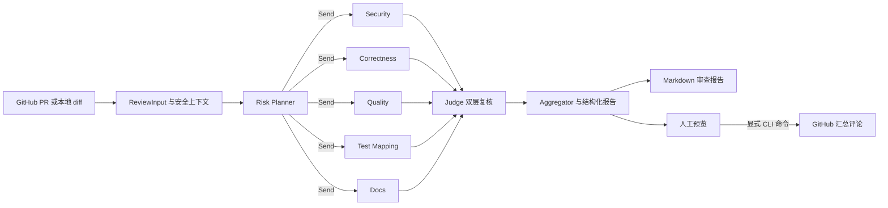

# Multi-Agent PR Review System

这是基于 [Om Solanki 的 multi-agent-code-reviewer](https://github.com/OmkumarSolanki/multi-agent-code-reviewer) 的二次开发，用于展示可审计的 Python PR 审查流程，定位为原型。保留上游 [MIT License](LICENSE) 和原作者版权。上游已有 LangGraph `Send` 并行派发、Security/Quality/Test Mapping/Docs 四个 Reviewer、Semgrep/Ruff/AST、CLI/FastAPI/GitHub 接入、基础重试与聚合；这些能力不计入本次新增。

| 本次扩展 | 用处 |
|---|---|
| OpenAI-compatible Qwen 接入 | 用户明确配置 DashScope endpoint、模型和密钥；结构化输出有界修复 |
| 本地 diff 与只读上下文工具 | 无 GitHub Token 也可审查；受限读取、AST 符号/引用、RIGHT hunk 定位 |
| Risk Planner 与 Correctness Reviewer | 根据变更风险派发 0–5 个 Reviewer，覆盖逻辑/边界/状态缺陷 |
| 独立 Judge | 校验路径/新增行/真实片段，再进行反证；保留原始、确认、驳回与待复核 |
| 预算与失败治理 | 共享并发/请求/工具/时间限制，partial/failed 可见，真实 token 缺失为 null |
| 可读审查报告 | 同一份审查结果生成 Markdown，包含问题、触发条件、建议与未完成复核说明；JSON 继续用于程序读取 |
| 受控发布与评测 | 默认 dry-run；单独预览/发布、head SHA 与幂等标识；20 例冻结数据及 A/B/C/D 消融入口 |



## Windows PowerShell 快速开始

支持 Python 3.11/3.12。项目目录内创建专用环境：

```powershell
py -3.11 -m venv .venv
.\.venv\Scripts\python.exe -m pip install -e ".[dev]"
.\.venv\Scripts\python.exe -m pytest -q
```

本地 diff 默认使用离线 Mock，无付费 API、无需 GitHub Token：

```powershell
git -c core.quotepath=false diff --no-ext-diff > review.diff
.\.venv\Scripts\reviewer.exe review-diff --diff review.diff --repo-path . --output report.json
```

命令会同时生成 `report.json` 和同目录的 `report.md`。若只需要可读报告，可将
`--output` 指向 `.md` 文件；`--markdown-output` 可指定 Markdown 文件的其他路径。
已有 JSON 也能直接转换，不需要再次调用模型：

```powershell
.\.venv\Scripts\reviewer.exe render-report --report report.json --output report.md
```

也可以启动本地测试页面（仅监听 `127.0.0.1:8765`）：

```powershell
.\.venv\Scripts\python.exe scripts/run_local_ui.py
```

在浏览器打开 `http://127.0.0.1:8765`，点击“载入示例”，然后运行离线审查。
页面也支持粘贴或选择 `.diff` 文件、填写补丁新版本的代码目录，以及选择 Agent。
真实 Qwen 调用须勾选“调用真实 Qwen”；启动脚本从项目根目录加载 `.env`，
页面不显示密钥，也不提供 GitHub 评论发布入口。审查完成后显示可读报告，
并可分别下载 Markdown 报告和 JSON 数据。
HTTP `POST /review` 默认保留 JSON 响应；请求体设置 `"response_format": "markdown"`
时直接返回同一份可读报告。

真实 Qwen 需由操作者填写自己所在地域/工作空间的 OpenAI-compatible endpoint 与模型：

```powershell
$env:LLM_PROVIDER = 'qwen'
$env:DASHSCOPE_API_KEY = '<your-key>'
$env:DASHSCOPE_BASE_URL = 'https://<your-openai-compatible-endpoint>'
$env:DASHSCOPE_MODEL = '<your-model>'
.\.venv\Scripts\python.exe scripts/smoke_qwen.py --live
.\.venv\Scripts\reviewer.exe review-diff --diff review.diff --repo-path . --live --output report-live.json
```

若希望在模型**明确返回免费额度耗尽**时自动切换，可一次性配置有序候选列表：

```dotenv
LLM_PROVIDER=qwen
DASHSCOPE_MODEL=qwen3.5-27b
DASHSCOPE_FALLBACK_MODELS=qwen-plus-2025-12-01
```

候选模型共用现有的 DashScope API Key 和同一区域的 Base URL。仅在服务端明确返回 `AllocationQuota.FreeTierOnly` 或 `Free allocated quota exceeded` 时切换；普通限流、网络错误、密钥错误和模型无权限均不切换。最多配置四个后备模型。报告的 `usage.models_used` 与 `usage.model_failovers` 记录实际模型；正式评测应固定单一模型，或按实际模型分别统计。免费额度耗尽后部分模型可能继续按量计费；若只允许使用免费额度，需先在百炼控制台对每个适用模型启用“仅免费额度”。

审查 GitHub PR 时执行：

```powershell
$env:GITHUB_TOKEN = '<your-token>'  # 私有仓库才要求读取授权；发布须具备写评论权限
.\.venv\Scripts\reviewer.exe review https://github.com/owner/repo/pull/42 --live --output pr-report.json
.\.venv\Scripts\reviewer.exe publish --report pr-report.json                    # 预览
.\.venv\Scripts\reviewer.exe publish --report pr-report.json --post-comments    # 显式发布
```

`publish` 仅接受 live、completed、Judge 验证完整且 head SHA 匹配的 GitHub 报告。HTTP API 拒绝直接发表评论。发布有远端幂等标识，但 GitHub 检查与写入不是原子操作；并发首发或最后检查后的 head 更新仍可能竞态。详情见 [HARNESS](docs/HARNESS.md)。

[Dockerfile](Dockerfile) 和 [docker-compose.yml](docker-compose.yml) 提供可选容器入口；Windows 本地 `.venv` 是当前验证过的环境。真实 Qwen 与 Windows Semgrep 已在下述 minishop 评测中运行；容器构建和真实 GitHub 评论仍未验证。被审查代码视为不可信输入，工具只读，不执行 PR 脚本或测试。对超长 diff 会记录省略覆盖；报告的 `completed` 表示流程完成，不代表无遗漏或可替代人工审查。

## 验证与评测

[阶段记录](docs/STAGE_RESULTS.md) 留有早期命令和结果；[架构](docs/ARCHITECTURE.md)、[设计取舍](docs/DECISIONS.md)、[测试](docs/TESTING.md)、[三段演示](docs/DEMO.md) 可以直接复现。首版冻结评测属于离线 Mock，不用于质量指标。扩充的 minishop 仓库评测完成了 16 个测试样例 × A/B/C/D 四组共 64 次真实 `qwen-max` 审查，结果和运行稳定性见 [完整报告](experiments/minishop-v1/REPORT.md)。这些标签由 Codex 模拟人工标注，尚无独立真人签核；多专家和 Judge 方案在本轮出现大量 `partial`，不能据此宣称优于单 Agent。旧版方法和配置见 [evals/README.md](evals/README.md)。

上游历史截图/性能数字曾出现在原 README；本版本不将它们呈现为二次开发的测量结果。详细改动与原实现边界见 [BASELINE](docs/BASELINE.md) 和 [IMPLEMENTATION_NOTES](docs/IMPLEMENTATION_NOTES.md)。

## License

MIT。详见 [LICENSE](LICENSE)，保留原作者版权声明。
