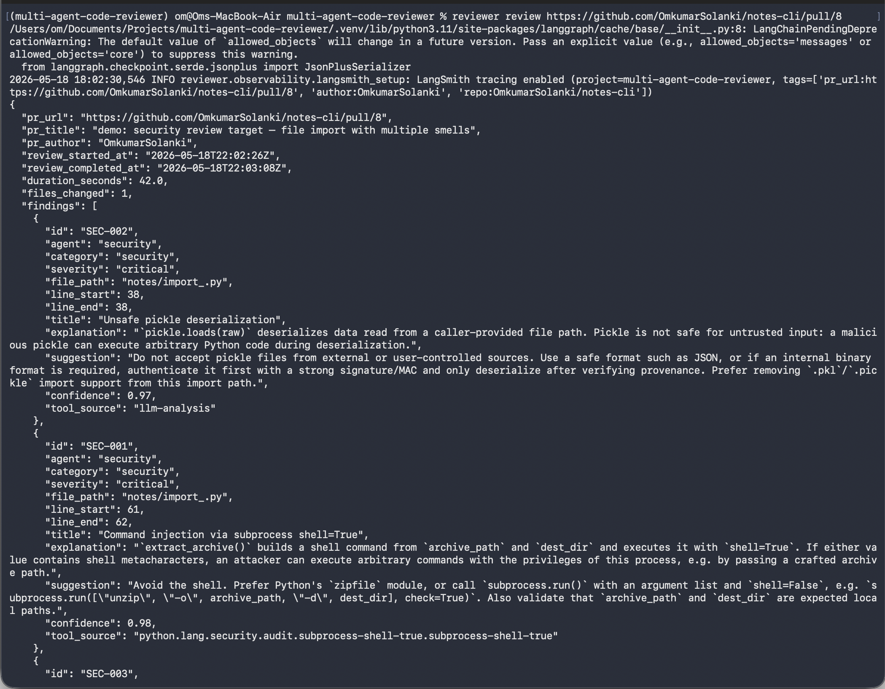
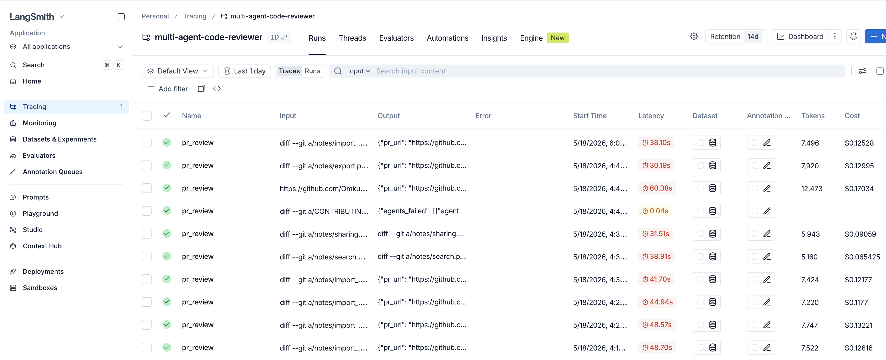
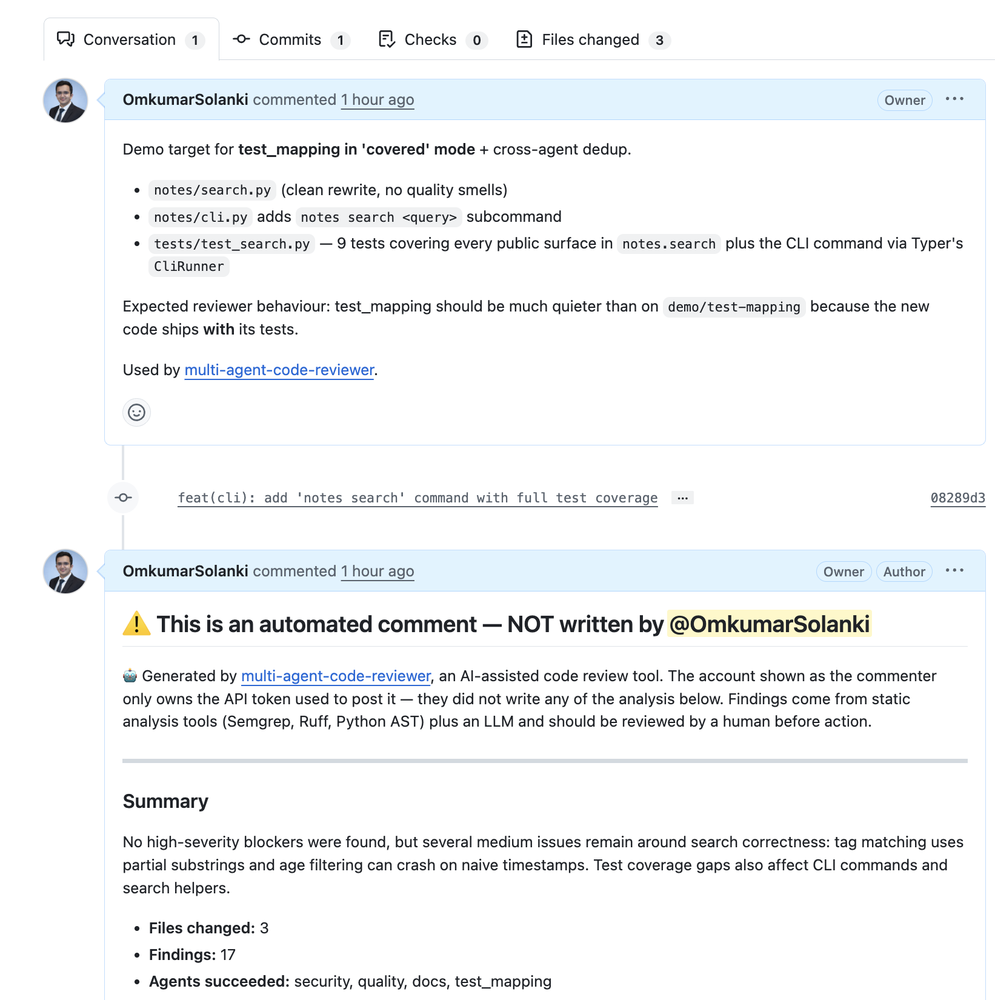
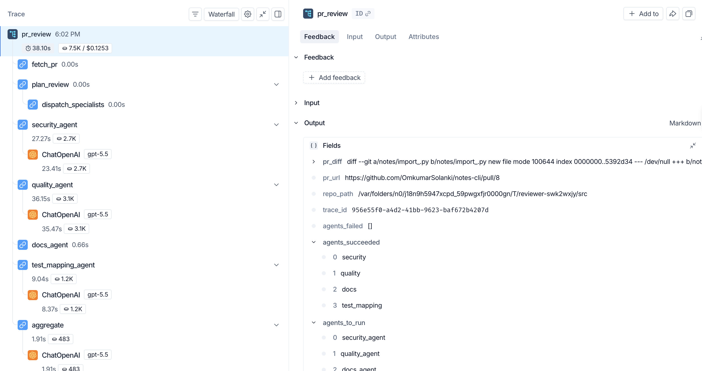
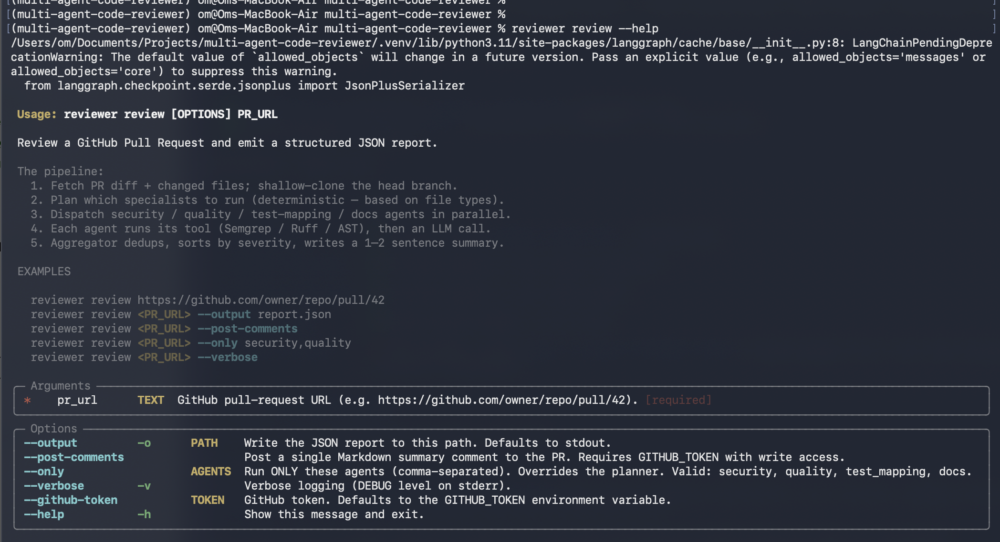

<div align="center">

# 🤖 Multi-Agent Code Reviewer

**Automated GitHub PR review by four specialist AI agents working in parallel.**

[](https://github.com/OmkumarSolanki/multi-agent-code-reviewer/actions/workflows/ci.yml)
[](https://www.python.org/downloads/)
[](#license)
[](#-development)
[](https://github.com/astral-sh/ruff)

Built with [LangGraph](https://langchain-ai.github.io/langgraph/) · [Anthropic Claude](https://www.anthropic.com/) / [OpenAI](https://openai.com/) · [Pydantic](https://docs.pydantic.dev/) · [Semgrep](https://semgrep.dev/) · [Ruff](https://docs.astral.sh/ruff/)

---

### See it in action



*A real review running against a public PR. Output is structured `Finding` JSON, validated by Pydantic at every boundary.*

</div>

---

## 📊 Real-world performance

Numbers from real runs (LangSmith trace data, not synthetic benchmarks):

| Metric | Value |
|---|---|
| **Median wall-clock** | ~38 seconds for a small PR |
| **Cost per review** | $0.06 – $0.17 (typical 5K – 12K tokens) |
| **Parallel speedup** | True — 4 agents run concurrently via LangGraph `Send` API |
| **Failure isolation** | Per-agent — one agent crashing never blocks the report |



*LangSmith dashboard showing real PR-review runs with per-call latency and cost.*

---

## 📖 Table of Contents

- [What it does](#-what-it-does)
- [Why agentic?](#-why-agentic-multiple-agents-instead-of-one)
- [Architecture](#-architecture)
- [Visual proof: parallel execution](#-visual-proof-parallel-execution)
- [Quick Start](#-quick-start)
- [Sample Output](#-sample-output)
- [How It Works](#-how-it-works)
- [CLI Reference](#-cli-reference)
- [HTTP API](#-http-api)
- [Docker](#-docker)
- [Configuration](#%EF%B8%8F-configuration)
- [Reliability](#%EF%B8%8F-reliability)
- [Schemas](#-schemas)
- [Limitations](#-limitations)
- [Roadmap](#%EF%B8%8F-roadmap)
- [Development](#-development)
- [Project Structure](#-project-structure)
- [Acknowledgments](#-acknowledgments)
- [License](#license)

---

## 🎯 What it does

You point it at a GitHub Pull Request URL. It returns a structured JSON report identifying:

- 🔒 **Security issues** — hardcoded secrets, SQL injection, weak crypto, timing attacks, unsafe deserialization
- 🧹 **Code quality** — style, complexity, naming, DRY violations, smells beyond what linters catch
- 🧪 **Missing tests** — changed functions and classes that no test file references
- 📝 **Missing docs** — public APIs lacking docstrings, with one-line suggestions

```bash
$ reviewer review https://github.com/owner/repo/pull/42 --output report.json --post-comments
```

When `--post-comments` is set, it also posts a Markdown summary back to the PR — clearly attributed as bot-generated:



*The bot makes its disclaimer explicit so reviewers and authors know the analysis came from an LLM-augmented pipeline, not a human.*

Two interfaces ship today: a **CLI** (`reviewer review …`) and an **HTTP API** (`POST /review`). Both share the same async core, so behavior is identical between them.

The scope is intentionally narrow: **Python repositories only for v1.** [Multi-language is on the roadmap.](#%EF%B8%8F-roadmap)

---

## 💡 Why agentic? (Multiple agents instead of one)

A single AI reviewer reading the whole PR with one giant prompt has problems:

1. **Bloated context.** Loading security rulesets + style rules + test patterns + doc conventions into one prompt makes the LLM less focused on any one dimension.
2. **Different tools.** Security uses Semgrep. Quality uses Ruff. Test mapping walks ASTs against test directories. Sequencing all of this through one agent is slow.
3. **Different mindsets.** A "security analyst" reasons differently than a "documentation reviewer." Specialist personas write better findings.
4. **Failure isolation.** If the security agent crashes, the others still produce useful output. Single-agent failure is total.
5. **Real parallelism.** Four agents finish in roughly the time of the slowest one, not the sum.

The four chosen specialists — **security, quality, test mapping, docs** — are the minimum viable set for meaningful review without becoming unmanageable.

---

## 🏗️ Architecture

```
                    User submits PR URL
                            │
                            ▼
            ┌───────────────────────────────┐
            │  Planning Node (deterministic)│
            │  → decides which agents to run│
            └───────────────────────────────┘
                            │
              ┌──────┬──────┴──────┬──────────┐
              ▼      ▼             ▼          ▼
         ┌────────┐ ┌────────┐ ┌────────┐ ┌────────┐
         │Security│ │Quality │ │  Test  │ │  Docs  │
         │ Agent  │ │ Agent  │ │ Mapping│ │ Agent  │
         └────────┘ └────────┘ └────────┘ └────────┘
              │      │             │          │
         Semgrep   Ruff/AST     AST+test     AST
            +LLM   +LLM          mapping     +LLM
              │      │             │          │
              └──────┴──────┬──────┴──────────┘
                            ▼
            ┌───────────────────────────────┐
            │   Aggregator                  │
            │   (dedup, sort, LLM summary)  │
            └───────────────────────────────┘
                            │
                            ▼
                  Structured JSON Report
```

All four specialists run in parallel via LangGraph's [`Send` API](https://langchain-ai.github.io/langgraph/concepts/low_level/#send). Total review time is bounded by the **slowest** agent, not the sum.

### The deterministic-first pattern

Every specialist follows the same shape: **deterministic tool first, LLM second.**

| Agent           | Deterministic tool                          | LLM role                                                              | Timeout |
|-----------------|---------------------------------------------|-----------------------------------------------------------------------|---------|
| 🔒 **Security** | Semgrep (`p/python` ruleset)                | Explain findings, suggest fixes, find what Semgrep missed             | 60s     |
| 🧹 **Quality**  | Ruff + AST cyclomatic complexity            | Spot smells, naming issues, DRY violations beyond what Ruff catches   | 45s     |
| 🧪 **Test Map** | AST cross-reference vs. test files          | Recommend tests for uncovered or partially-covered entities           | 30s     |
| 📝 **Docs**     | AST scan for missing docstrings on public APIs | Suggest one-line docstrings based on signature                     | 30s     |

Why this pattern? Pure-LLM analysis hallucinates issues and misses known-bad patterns. Pure-rule analysis can't reason about *why* something is wrong. Pairing them gets **high-precision detection (rules) + high-recall reasoning + explanations (LLM)** — the production sweet spot.

---

## 🔬 Visual proof: parallel execution

A LangSmith trace from a real review:



The math: `security_agent` took 27s, `quality_agent` took 36s — yet the entire `pr_review` finished in **38 seconds total**. If the agents were sequential, total would be ~73s. The parallel `Send` dispatch is doing real work.

Notice also:
- `dispatch_specialists` itself takes 0s — it's a pure router, no state mutation.
- `fetch_pr` and `plan_review` are 0s because the runner pre-fetches outside the graph (so the cloned tempdir is owned by the caller, not the graph).
- `aggregate` runs after all specialists converge — dedup, sort, then a single LLM call for the executive summary.

---

## 🚀 Quick Start

### 1. Install

```bash
git clone https://github.com/OmkumarSolanki/multi-agent-code-reviewer.git
cd multi-agent-code-reviewer

python -m venv .venv && source .venv/bin/activate
pip install -e ".[dev]"
```

### 2. Install Semgrep

Semgrep is a CLI tool, not a Python dependency. The security agent shells out to it.

```bash
brew install semgrep             # macOS
# or
pipx install semgrep             # cross-platform
```

### 3. Configure

```bash
cp .env.example .env
```

Edit `.env` — pick whichever LLM provider you have credits for:

```bash
# Option A: Claude (default)
ANTHROPIC_API_KEY=sk-ant-...

# Option B: OpenAI
OPENAI_API_KEY=sk-...
LLM_PROVIDER=openai

# Required for posting PR comments / private repos
GITHUB_TOKEN=ghp_...

# Override the model if needed
LLM_MODEL=claude-sonnet-4-6        # default for anthropic
# LLM_MODEL=gpt-4o                 # default for openai
```

LangSmith tracing is **optional** — set `LANGCHAIN_TRACING_V2=true` and `LANGCHAIN_API_KEY=…` to enable.

### 4. Run

```bash
# Review a PR and write JSON to stdout
reviewer review https://github.com/owner/repo/pull/42

# Write to a file and post a Markdown summary as a PR comment
reviewer review https://github.com/owner/repo/pull/42 \
  --output report.json \
  --post-comments

# Run only specific agents (overrides the planner)
reviewer review https://github.com/owner/repo/pull/42 --only security,quality
```

Or run as an HTTP service:

```bash
uvicorn reviewer.api:app --host 0.0.0.0 --port 8000

curl -X POST http://localhost:8000/review \
  -H 'content-type: application/json' \
  -d '{"pr_url": "https://github.com/owner/repo/pull/42"}'
```

---

## 📋 Sample Output

A real-shaped report lives in [`examples/sample_review_output.json`](examples/sample_review_output.json). Excerpt:

```json
{
  "pr_url": "https://github.com/example/repo/pull/42",
  "pr_title": "Add user authentication endpoint",
  "pr_author": "alice",
  "review_started_at": "2026-05-17T14:00:00Z",
  "review_completed_at": "2026-05-17T14:01:23Z",
  "duration_seconds": 83.0,
  "files_changed": 4,
  "summary": "Found 1 high-severity timing-attack risk and 1 hardcoded token in app/auth.py, plus complexity, missing docstrings, and a missing test for Session.refresh. Fix the timing-comparison and rotate the token before merge.",
  "findings": [
    {
      "id": "F-001",
      "agent": "security",
      "category": "security",
      "severity": "high",
      "file_path": "app/auth.py",
      "line_start": 23,
      "line_end": 23,
      "title": "Password compared with == instead of constant-time comparison",
      "explanation": "Comparing passwords with == leaks timing information to attackers...",
      "suggestion": "Replace `if password == stored_password:` with `if secrets.compare_digest(password, stored_password):`.",
      "confidence": 0.92,
      "tool_source": "semgrep:python.lang.security.unsafe-eq"
    }
  ],
  "agents_succeeded": ["security", "quality", "test_mapping", "docs"],
  "agents_failed": [],
  "trace_id": "1f3b9d2e-7a8c-4e9f-8b1a-2c3d4e5f6a7b"
}
```

---

## ⚙️ How It Works

A review walks through these stages:

1. **Fetch.** An async GitHub client downloads the PR diff, file list, and metadata via REST, then `git clone --depth=1` of the head branch into a `tempfile.TemporaryDirectory` so Semgrep can resolve cross-file references.
2. **Plan.** Deterministic Python rules examine file extensions and emit `agents_to_run`. README-only PR? Run nothing. Python source touched? Run all four.
3. **Dispatch.** LangGraph's `add_conditional_edges` routes a list of `Send(agent_name, state)` to spawn each agent **in parallel**.
4. **Specialist work.** Each agent runs its deterministic tool, builds a prompt combining tool output + PR diff, and calls the LLM with `with_structured_output(FindingList)` to get Pydantic-validated findings back.
5. **Reduce.** Each agent returns a state patch; `Annotated[list[Finding], add]` reducers append from each branch into the shared `findings` list as agents finish.
6. **Aggregate.** The final node deduplicates on `(file_path, line_start, category)` keeping the highest severity, sorts by severity → file → line, and asks the LLM for a 1–2 sentence executive summary (with retry + deterministic fallback).
7. **Return.** A `ReviewReport` JSON. Optionally a Markdown summary comment is posted back to the PR.

### Aggregation rules

- **Dedup key**: `(file_path, line_start, category)` — keeps highest severity, first-seen wins on ties (preserves the richer LLM-written explanation over a tool seed).
- **Sort order**: severity desc → file path asc → `line_start` asc (None last).
- **Summary**: LLM-generated with up to 2 retries on Pydantic validation failure, falling back to `"Review complete — see findings below."` if all retries fail.

---

## 📐 CLI Reference



*Run `reviewer review --help` to see the full subcommand options inline. The CLI is a thin wrapper around the same `run_review` async core that powers the HTTP API — behavior is identical between them.*

```text
reviewer review PR_URL [OPTIONS]

Arguments:
  PR_URL  GitHub pull-request URL.                             [required]

Options:
  -o, --output PATH       Write the JSON report here. Stdout if omitted.
  --post-comments         Post a single Markdown summary comment to the PR.
                          Requires GITHUB_TOKEN with write access.
  --only TEXT             Run ONLY these agents (comma-separated). Overrides
                          the planner.
                          Valid: security, quality, test_mapping, docs.
  -v, --verbose           Verbose logging (DEBUG level on stderr).
  --github-token TEXT     GitHub token. Defaults to $GITHUB_TOKEN.
  --env-file PATH         Path to a .env file. Defaults to ./.env.
  --help                  Show this message and exit.
```

---

## 🌐 HTTP API

| Endpoint        | Body                                                      | Response                                |
|-----------------|-----------------------------------------------------------|-----------------------------------------|
| `GET /health`   | —                                                         | `{"status":"ok","version":"0.1.0"}`     |
| `POST /review`  | `{pr_url, agents?, post_comments?, github_token?}`        | Full `ReviewReport` JSON                |

**Errors:**

| Status | Meaning                                                                |
|--------|------------------------------------------------------------------------|
| `400`  | Invalid PR URL.                                                        |
| `422`  | Missing or invalid request-body fields (FastAPI/Pydantic validation).  |
| `500`  | Pipeline failure (rare — most failures land in `agents_failed` and still return 200). |

OpenAPI docs auto-generated at `/docs` once the server is running.

---

## 🐳 Docker

```bash
docker build -t reviewer .

# CLI mode
docker run --rm \
  -e ANTHROPIC_API_KEY -e GITHUB_TOKEN \
  reviewer review https://github.com/owner/repo/pull/42

# API mode
docker run --rm -p 8000:8000 \
  -e ANTHROPIC_API_KEY -e GITHUB_TOKEN \
  reviewer uvicorn reviewer.api:app --host 0.0.0.0 --port 8000
```

A `docker-compose.yml` ships with both `reviewer-cli` and `reviewer-api` services. The image:

- Is multi-stage (`python:3.11-slim` builder + runtime).
- Pins `semgrep==1.85.0` in the runtime layer.
- Runs as a non-root user.
- Defaults to the CLI; pass `uvicorn …` as the command for API mode.

---

## ⚙️ Configuration

### Environment variables

| Variable                    | Required          | Description                                                       |
|-----------------------------|-------------------|-------------------------------------------------------------------|
| `LLM_PROVIDER`              | No                | `anthropic` (default) or `openai`. Controls which LLM client is built. |
| `ANTHROPIC_API_KEY`         | If provider=anthropic | Anthropic API key.                                            |
| `OPENAI_API_KEY`            | If provider=openai | OpenAI API key.                                                  |
| `LLM_MODEL`                 | No                | Override the model. Defaults: `claude-sonnet-4-6` / `gpt-4o`.     |
| `GITHUB_TOKEN`              | For private repos / `--post-comments` | GitHub token.                                  |
| `LANGCHAIN_TRACING_V2`      | No                | `true` to enable LangSmith tracing.                               |
| `LANGCHAIN_API_KEY`         | If tracing enabled| LangSmith API key.                                                |
| `LANGCHAIN_PROJECT`         | No                | LangSmith project name. Default `multi-agent-code-reviewer`.      |

### Per-target-repo configuration

The Test Mapping agent reads test directories from the **target repo's** `pyproject.toml`:

```toml
[tool.reviewer]
test_dirs = ["tests", "integration_tests"]
```

Defaults to `["tests"]` when the key is missing or malformed.

---

## 🛡️ Reliability

Built-in production hardening — **designed in, not retrofitted.**

- **Per-agent timeouts** (60s / 45s / 30s / 30s) via `asyncio.timeout`. Caught *inside* each node so LangGraph still records partial state when one agent times out.
- **Async retry** with exponential backoff (3 attempts, 1s → 2s → 4s, capped at 10s, with jitter) on LLM and GitHub calls. **`CancelledError` is never retried** — keeps `asyncio.timeout` and task cancellation working.
- **Per-endpoint circuit breakers** (CLOSED → OPEN → HALF_OPEN) — 5 failures in 60s opens the circuit for 30s, then admits a single probe. Prevents thundering-herd retries during provider outages.
- **Failure isolation.** Every agent catches its own exceptions and writes them to `agents_failed`. The aggregator tolerates partial results.
- **Aggregator summary fallback.** LLM retried up to 2× on Pydantic validation failure, then the deterministic string `"Review complete — see findings below."` is used.
- **Tool-seed fallbacks.** If an LLM call fails inside a specialist, the agent falls back to deterministic findings derived from its tool's output (Semgrep results → security seeds, Ruff diagnostics → quality seeds, etc.) so the user always gets *something*.

---

## 🧬 Schemas

### `Finding`

```jsonc
{
  "id": "F-001",
  "agent": "security|quality|test_mapping|docs",
  "category": "security|quality|test_coverage|documentation",
  "severity": "critical|high|medium|low|info",
  "file_path": "app/auth.py",
  "line_start": 23,        // optional (some findings have no line)
  "line_end": 25,
  "title": "Password compared with == instead of constant-time comparison",
  "explanation": "...",
  "suggestion": "...",
  "confidence": 0.92,      // [0.0, 1.0]
  "tool_source": "semgrep:python.lang.security.unsafe-eq"
}
```

### `ReviewReport`

```jsonc
{
  "pr_url":              "https://github.com/owner/repo/pull/42",
  "pr_title":            "Add user authentication endpoint",
  "pr_author":           "alice",
  "review_started_at":   "2026-05-17T14:00:00Z",
  "review_completed_at": "2026-05-17T14:01:23Z",
  "duration_seconds":    83.2,
  "files_changed":       4,
  "findings":            [/* Finding[] sorted by severity */],
  "summary":             "1-2 sentence executive overview",
  "agents_succeeded":    ["security", "quality", "test_mapping", "docs"],
  "agents_failed":       [{"agent": "...", "error": "..."}],
  "trace_id":            "uuid4 or LangSmith trace id"
}
```

Severity is an enum, never free-form. Findings without line numbers are allowed.

---

## ⚠️ Limitations

Honest about what v1 does **not** do:

- **Python only.** The Test Mapping and Docs agents use Python's stdlib `ast`. JS/TS/Go/Java would require [tree-sitter](https://tree-sitter.github.io/) and per-language linter wrappers. See the [roadmap](#%EF%B8%8F-roadmap).
- **Static test mapping, not coverage measurement.** It identifies whether a test file *references* a changed entity by name; it does **not** execute tests. Dynamic patterns (runtime imports, `getattr` lookups) can produce false negatives.
- **Single-summary PR comments.** Inline-per-line comments would require diff-position math; deferred to v2.
- **No caching.** Every review runs the full pipeline fresh. Roughly **$0.06–$0.17 per review** in LLM API calls for a typical small PR.
- **No `.reviewer.yml` config** beyond the `[tool.reviewer]` block in the target repo's `pyproject.toml`.

---

## 🗺️ Roadmap

Things that would be genuine value-adds, in rough priority order:

- [ ] **JavaScript / TypeScript support** via tree-sitter + ESLint
- [ ] **Inline PR comments** (per-line, not just summary)
- [ ] **Gemini provider** (Anthropic + OpenAI ship today)
- [ ] **Go support**
- [ ] **Result caching** keyed on `(repo, head_sha)` to skip re-review
- [ ] **GitHub App** with webhook triggers (no more manual URL passing)
- [ ] **Per-repo `.reviewer.yml`** for custom severity weights, agent enable/disable
- [ ] **Java + Ruby** support

PRs welcome — see [Development](#-development).

---

## 🧪 Development

```bash
# Run the full test suite
pytest

# Single test file
pytest tests/test_security_agent.py

# Opt-in live tests (hit real network / require external binaries)
pytest -m live

# Lint
ruff check reviewer tests
```

### Live tests

Live tests are **gated by environment variables** so they never run in CI by default:

| Variable                  | What it enables                                                      |
|---------------------------|----------------------------------------------------------------------|
| `REVIEWER_LIVE_PR_URL=…`  | Live `fetch_pr` test against the given real PR.                      |
| `REVIEWER_LIVE_SEMGREP=1` | `semgrep_runner` against the fixture (requires `semgrep` on `PATH`). |
| `REVIEWER_LIVE_RUFF=1`    | `ruff_runner` against the fixture. (Ruff is in `[dev]`.)             |

### Test stats

- **279 unit tests passing**, 3 live-skipped by default.
- Suite runs in **~2.7 seconds** locally.
- All tool subprocesses and LLM calls are mocked — no API key needed for development.

### Continuous Integration

GitHub Actions runs on every push and PR:

1. `ruff check` (lint)
2. `pytest` (full suite, live tests skipped)
3. `docker build` (no push)

See [`.github/workflows/ci.yml`](.github/workflows/ci.yml).

### Contributing

PRs welcome. Please:

1. Open an issue first if it's a non-trivial change.
2. Add tests for new behavior — the bar is "if it's not tested, it's not done."
3. Keep `ruff check` clean.
4. Match the project's existing style (async-first, dataclasses for tool results, Pydantic for LLM-bound schemas).

---

## 📁 Project Structure

```
reviewer/
├── __init__.py
├── cli.py                    # Typer CLI entrypoint
├── api.py                    # FastAPI HTTP entrypoint
├── runner.py                 # Shared async run_review() — used by CLI + API
├── config.py                 # Centralized env-reading shim
├── agents/
│   ├── base.py               # get_llm() + analyze_with_schema() (retry+breaker wrapped)
│   ├── security.py           # security_agent_node
│   ├── quality.py            # quality_agent_node
│   ├── test_mapping.py       # test_mapping_agent_node
│   └── docs.py               # docs_agent_node
├── graph/
│   ├── state.py              # ReviewState TypedDict + AGENT_NODE_TO_LABEL
│   ├── planner.py            # deterministic plan_review_node
│   ├── builder.py            # build_review_graph() with Send dispatcher
│   └── aggregator.py         # dedup + sort + LLM summary
├── tools/
│   ├── github_client.py      # async fetch_pr() + retry + circuit breaker
│   ├── semgrep_runner.py     # async subprocess wrapper, JSON parse
│   ├── ruff_runner.py        # async subprocess wrapper, JSON parse
│   └── ast_inspector.py      # find_functions / find_classes / find_references
├── reliability/
│   ├── retry.py              # async_retry decorator
│   └── circuit_breaker.py    # CircuitBreaker dataclass
├── models/
│   ├── findings.py           # Finding, Severity, Category
│   └── report.py             # ReviewReport, AgentFailure
└── observability/
    └── langsmith_setup.py    # optional tracing config
tests/                        # 19 test modules + fixture sample repo
docs/images/                  # README screenshots
examples/
└── sample_review_output.json
scripts/
└── generate_sample_output.py # regenerates the example through the real aggregator
.github/workflows/ci.yml
Dockerfile
docker-compose.yml
pyproject.toml
```

---

## 🙏 Acknowledgments

Built with these excellent open-source tools:

- [LangGraph](https://langchain-ai.github.io/langgraph/) — agent orchestration with the `Send` API for parallel dispatch
- [LangChain](https://www.langchain.com/) — LLM glue, structured outputs, integrations
- [Anthropic Claude](https://www.anthropic.com/) and [OpenAI](https://openai.com/) — the LLMs behind every specialist's reasoning step
- [Semgrep](https://semgrep.dev/) — security static analysis with community-maintained rule packs
- [Ruff](https://docs.astral.sh/ruff/) — blazingly fast Python linter
- [Pydantic](https://docs.pydantic.dev/) — schema enforcement on every LLM output
- [PyGithub](https://pygithub.readthedocs.io/) + [httpx](https://www.python-httpx.org/) — GitHub API client + async HTTP
- [FastAPI](https://fastapi.tiangolo.com/) + [Typer](https://typer.tiangolo.com/) — HTTP and CLI surface

---

## License

[MIT](LICENSE) © Om Solanki

---

<div align="center">

**Found a bug? Have an idea?** [Open an issue.](https://github.com/OmkumarSolanki/multi-agent-code-reviewer/issues)

⭐ If this is useful to you, a star helps others find it.

</div>
