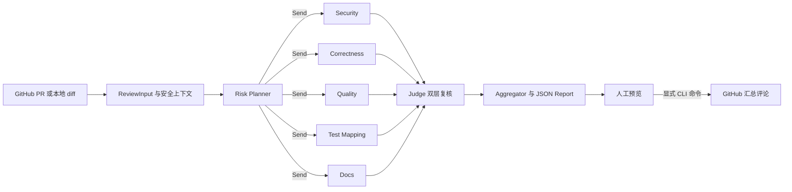

# Multi-Agent PR Review System

这是基于 [Om Solanki 的 multi-agent-code-reviewer](https://github.com/OmkumarSolanki/multi-agent-code-reviewer) 的二次开发，用于展示可审计的 Python PR 审查流程，定位为原型。保留上游 [MIT License](LICENSE) 和原作者版权。上游已有 LangGraph `Send` 并行派发、Security/Quality/Test Mapping/Docs 四个 Reviewer、Semgrep/Ruff/AST、CLI/FastAPI/GitHub 接入、基础重试与聚合；这些能力不计入本次新增。

| 本次扩展 | 用处 |
|---|---|
| OpenAI-compatible Qwen 接入 | 用户明确配置 DashScope endpoint、模型和密钥；结构化输出有界修复 |
| 本地 diff 与只读上下文工具 | 无 GitHub Token 也可审查；受限读取、AST 符号/引用、RIGHT hunk 定位 |
| Risk Planner 与 Correctness Reviewer | 根据变更风险派发 0–5 个 Reviewer，覆盖逻辑/边界/状态缺陷 |
| 独立 Judge | 校验路径/新增行/真实片段，再进行反证；保留原始、确认、驳回与待复核 |
| 预算与失败治理 | 共享并发/请求/工具/时间限制，partial/failed 可见，真实 token 缺失为 null |
| 受控发布与评测 | 默认 dry-run；单独预览/发布、head SHA 与幂等标识；20 例冻结数据及 A/B/C/D 消融入口 |



## Windows PowerShell 快速开始

支持 Python 3.11/3.12。项目目录内创建专用环境：

```powershell
py -3.11 -m venv .venv
.\.venv\Scripts\python.exe -m pip install -e ".[dev]"
.\.venv\Scripts\python.exe -m pytest -q
```

本地 diff 默认使用离线 Mock，无付费 API、无需 GitHub Token：

```powershell
git -c core.quotepath=false diff --no-ext-diff > review.diff
.\.venv\Scripts\reviewer.exe review-diff --diff review.diff --repo-path . --output report.json
```

也可以启动本地测试页面（仅监听 `127.0.0.1:8765`）：

```powershell
.\.venv\Scripts\python.exe scripts/run_local_ui.py
```

在浏览器打开 `http://127.0.0.1:8765`，点击“载入示例”，然后运行离线审查。
页面也支持粘贴或选择 `.diff` 文件、填写补丁新版本的代码目录，以及选择 Agent。
真实 Qwen 调用须勾选“调用真实 Qwen”；启动脚本从项目根目录加载 `.env`，
页面不显示密钥，也不提供 GitHub 评论发布入口。审查结果可下载为 JSON。

真实 Qwen 需由操作者填写自己所在地域/工作空间的 OpenAI-compatible endpoint 与模型：

```powershell
$env:LLM_PROVIDER = 'qwen'
$env:DASHSCOPE_API_KEY = '<your-key>'
$env:DASHSCOPE_BASE_URL = 'https://<your-openai-compatible-endpoint>'
$env:DASHSCOPE_MODEL = '<your-model>'
.\.venv\Scripts\python.exe scripts/smoke_qwen.py --live
.\.venv\Scripts\reviewer.exe review-diff --diff review.diff --repo-path . --live --output report-live.json
```

审查 GitHub PR 时执行：

```powershell
$env:GITHUB_TOKEN = '<your-token>'  # 私有仓库才要求读取授权；发布须具备写评论权限
.\.venv\Scripts\reviewer.exe review https://github.com/owner/repo/pull/42 --live --output pr-report.json
.\.venv\Scripts\reviewer.exe publish --report pr-report.json                    # 预览
.\.venv\Scripts\reviewer.exe publish --report pr-report.json --post-comments    # 显式发布
```

`publish` 仅接受 live、completed、Judge 验证完整且 head SHA 匹配的 GitHub 报告。HTTP API 拒绝直接发表评论。发布有远端幂等标识，但 GitHub 检查与写入不是原子操作；并发首发或最后检查后的 head 更新仍可能竞态。详情见 [HARNESS](docs/HARNESS.md)。

[Dockerfile](Dockerfile) 和 [docker-compose.yml](docker-compose.yml) 提供可选容器入口；Windows 本地 `.venv` 是当前验证过的环境。容器构建、真实 Qwen、真实 GitHub 评论及 Windows Semgrep 均 **NOT_RUN**。被审查代码视为不可信输入，工具只读，不执行 PR 脚本或测试。对超长 diff 会记录省略覆盖；报告的 `completed` 表示流程完成，不代表无遗漏或可替代人工审查。

## 验证与评测

[阶段记录](docs/STAGE_RESULTS.md) 留有实际命令和结果；[架构](docs/ARCHITECTURE.md)、[设计取舍](docs/DECISIONS.md)、[测试](docs/TESTING.md)、[三段演示](docs/DEMO.md) 可以直接复现。评测首版有 20 个原创样例，10 dev / 10 test，SHA 固定；离线执行 80 次 A/B/C/D 运行及 36 次三轮重复。报告标为 `not_live_benchmark`，质量指标为 null。标注待人工签核，真实 Qwen 消融尚未运行，因此没有可报告的 Precision/Recall、误报减少量或真实成本优势。评测方法、四组配置与后续人工匹配流程见 [evals/README.md](evals/README.md)。

上游历史截图/性能数字曾出现在原 README；本版本不将它们呈现为二次开发的测量结果。详细改动与原实现边界见 [BASELINE](docs/BASELINE.md) 和 [IMPLEMENTATION_NOTES](docs/IMPLEMENTATION_NOTES.md)。

## License

MIT。详见 [LICENSE](LICENSE)，保留原作者版权声明。
