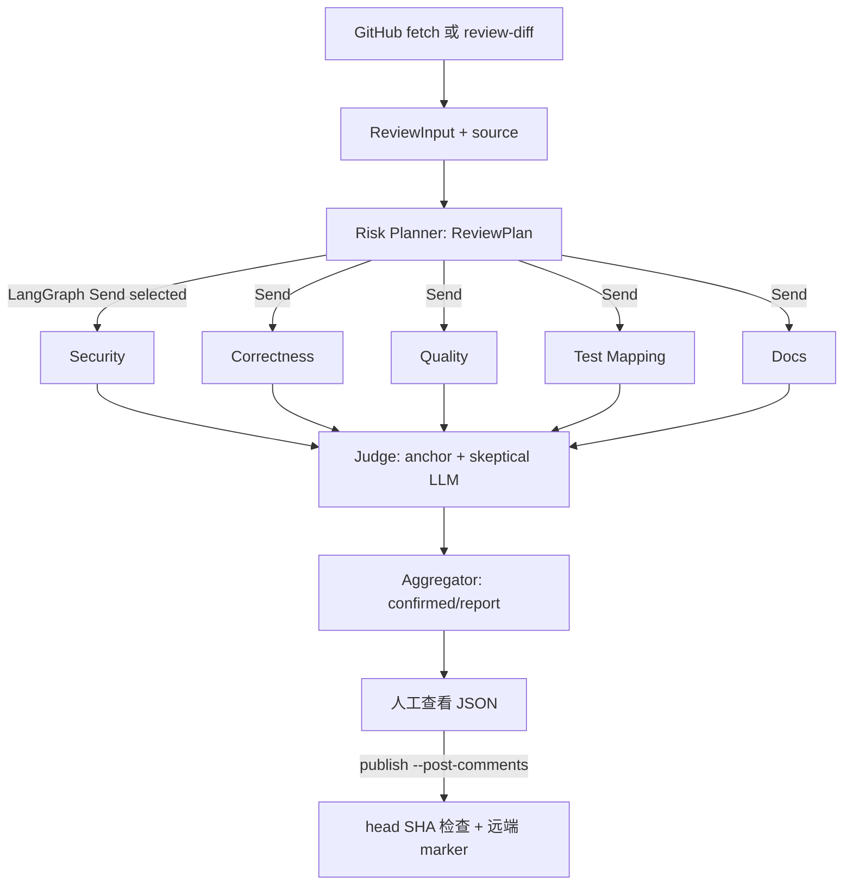

# 架构与状态流

入口 `reviewer/cli.py` 和 `reviewer/api.py` 调用 `reviewer/runner.py`；本地 diff 与 GitHub
输入都进入 `_execute_review`。`tools/diff_input.py` 将 unified diff 解析为 ReviewInput，
保留文件、完整 hunk、RIGHT 新行、SHA-256 和省略覆盖；`changed_sources` 从仓库根读取
对应新版本 UTF-8 文件。所有路径通过 `CodeContext` 检查，禁止绝对路径、`..`、
符号链接、`.env` 等文件。AST 搜索不导入/执行受审源码。

上游四节点、Send 路由、静态工具和聚合仍被调用。新增 Correctness 节点使用相同的
`FindingList`/`analyze_with_schema` 适配器。规则 Planner 给安全风险确定性路由底座；
hybrid 的模型建议经 Pydantic 与白名单校验，无法删除规则底座。空路由为 `skipped`。

图的 `ReviewState` 保存 `review_input`、`pr_diff`、`changed_files`、`review_plan`、
`agents_to_run`、`findings`（候选）、`raw_findings`、`verified_findings`、
`tool_evidence`、`budget_events`、`agents_succeeded/failed` 与 `final_report`。
多分支的候选/成功/失败/证据字段使用 `add` reducer。Judge 先检查路径、RIGHT 行、
原文片段和 checkout 一致，再给独立模型局部证据请求反证；输出
`confirmed/rejected/uncertain` 和理由。Judge 失败将候选保留为 uncertain。

`RunHarness` 在图运行外独立持有共享请求锁与并发 Semaphore；ContextVar 使并发运行
互不污染。每个节点 wrapper 保存增量快照和脱敏 trace，整体超时可返回 partial。
真实 usage 只有模型返回时计数，未知为 null。默认 Mock 模式不访问付费模型，
静态子进程也被跳过。LLM prompt 包裹为不可信 JSON，模型不能授权新工具或发布。

HTTP 只返回 JSON，不允许客户端直接发表评论。CLI 的单独 `publish` 是人工发布点。
报告带 `input_mode/head_sha/diff_sha256/reviewed_files/coverage`，发布前必须检验
GitHub head 与审查版本；远端 marker 防止顺序重复评论。工程限制见 HARNESS.md。
